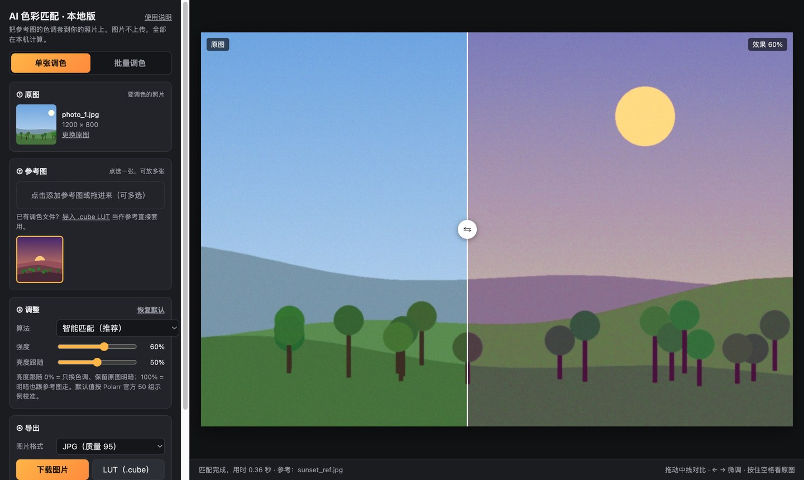
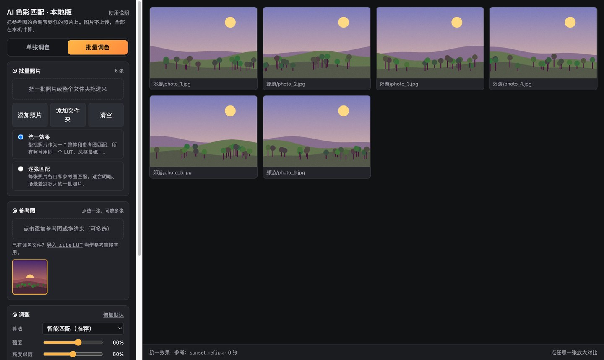

# AI 色彩匹配 · 本地版

把参考图的色调一键套到你的照片上，支持单张调色和**批量调色**。功能对标 [Polarr AI Color Match](https://colormatch.polarr.com/)，但**全部在本机浏览器里计算，图片不会上传**。

**在线使用：<https://tianfeng66.github.io/ai-color-match/>**（打开即用，不用安装）

## 功能

- **单张调色**：放入原图和一张或多张参考图，点选参考图即出效果；中线拖动对比原图，按住空格看原图。
- **批量调色**：把一批照片或整个文件夹拖进来，网格里实时显示每张效果，拖滑杆所有照片一起变。
  - 统一效果：整批照片作为一个整体和参考图匹配，所有照片用同一个 LUT，风格最统一。
  - 逐张匹配：每张照片各自和参考图匹配，适合明暗、场景差别很大的一批照片。
  - 导出到新建的「调色输出_日期时间」文件夹，子文件夹结构保持不变，原图不会被修改。
- **导入 .cube LUT**：手上已有的调色文件可以直接当参考，单张或批量套用。
- **导出**：原分辨率 JPG / PNG、`.cube`（PS / Premiere / 达芬奇 / Final Cut）、`.xmp`（Lightroom / ACR 预设），或全部打包成 zip。
- **调整**：5 种匹配算法、强度、亮度跟随（0% 只换色调保留原图明暗，100% 明暗也跟参考图）。

## 使用方法

1. 打开[在线版](https://tianfeng66.github.io/ai-color-match/)，或者下载本仓库里的 `index.html` 用浏览器双击打开（离线也能用）。
2. 单张：左侧放原图 → 添加参考图并点选 → 调强度 → 导出。
3. 批量：点「批量调色」→ 拖入照片或文件夹 → 选参考图 → 「导出全部」→ 选保存位置。

`examples/` 里有几张示例图，可以拿来先试一下。

## 浏览器要求

- 推荐新版 **Chrome / Edge**（Windows、Mac 都可以）。
- Safari、Firefox 也能用，但不能直接写文件夹，批量结果会打包成 zip 下载（超过 1.5 GB 自动分包）。
- HEIC / TIFF 只有 Safari 能打开，Chrome 里请先转成 JPG。
- 需要 WebGL2；浏览器太旧时页面顶部会有红色提示。

## 原理

和 Polarr 官网的流程一致：原图、参考图各缩到 256 像素做统计 → 生成一个 25×25×25 的 3D LUT → 用显卡（WebGL2）把 LUT 套到原分辨率图片上。

区别在生成 LUT 这一步：官网把两张小图发到 Polarr 服务器用 AI 模型生成；本地版在 OKLab 色彩空间里用 Monge-Kantorovich 线性映射 + 迭代分布迁移（Pitié 2005）在本机生成。默认参数（智能匹配 / 强度 60% / 亮度跟随 50%）按 Polarr 官方 50 组示例逐组比对校准；色调方向和官网一致，官网通常会再多提亮一点。

导出的 `.xmp` 使用 Adobe Camera Raw 的 RGBTable 格式（zlib 压缩 + ACR 专用 base85 编码）。

## 注意

- 单文件 HTML，没有任何外部依赖、不联网、不收集数据。
- `examples/` 里的示例图是程序生成的插画，可以随意使用。
